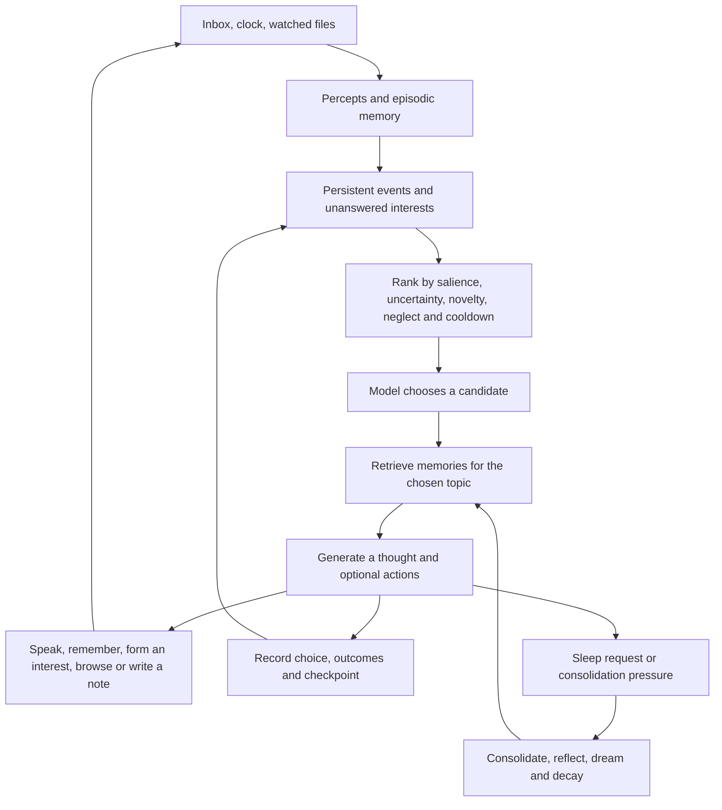

# Ukko cognitive architecture

Ukko investigates how a local model behaves when attention, memory and opportunities for action continue between conversations. The central design is a recurrent process that chooses its own next inquiry, observes the consequences of actions, and carries those experiences into later choices. Humans participate in its environment through text and eventually voice.

The first implementation extends Anima. Later components stay separable so experiments can identify which mechanism changes behavior. Terms such as attention, fatigue and curiosity name computational variables and research analogies. Their biological names do not establish that the implementation reproduces a brain or has subjective experience.

## Implemented recurrent loop



`anima/attention.py` owns the candidate pool and decision records in the existing SQLite database. `cognition.choose_attention` runs before retrieval, so the selected topic actually changes which memories the next thought receives. The model then generates a concrete continuation, can introduce a new interest, and can resolve the selected interest. A background observation candidate remains available when all interests are resolved.

Each human message is an event. It wakes the scheduling loop, but there is no mandatory conversational reflex in experimental mode. `say=null` produces silence. An attended event leaves the active pool after a successful thought; attendance records consideration, not a promise that it received a reply. A failed generation does not retire it. The original reflex mode remains available as a comparison.

The loop requests that the model remain resident. It still makes bounded generations rather than maintaining one unending token stream. Continuity currently lives in the external store and checkpoint. Transformer cache persistence and recurrence within hidden states are distinct future experiments.

## Attention allocation

The current score is:

```text
score = 2 × salience
      + 0.6 × uncertainty
      + age_weight × log(1 + neglected_seconds / age_scale_seconds)
      + novelty_bonus
      - recent_attendance_penalty
```

Percept importance supplies salience. An unanswered interest starts with salience 0.4 and uncertainty 0.6. Novelty is a first-visit bonus of 0.4; it does not yet measure semantic novelty. Attendance resets neglect and temporarily lowers priority. The logarithmic age term grows without a fixed ceiling, allowing a neglected topic to return to the shortlist. These coefficients are initial conditions to vary in experiments.

The controller offers the six highest scoring candidates. The model can choose any of them, with a reason recorded alongside every score component. Invalid IDs and selection errors yield an explicitly named controller fallback. A shortlist guarantees access to alternatives; it cannot guarantee that a model chooses them. Measure repeated refusal and selection bias directly.

There are two model calls per normal experimental cycle: selection and thought. Comparing this loop with one-call Anima requires matching total tokens or inference time. A future one-call variant can combine topic choice and thought, but it must still solve retrieval for a topic that has not yet been chosen.

The next attention extension should introduce prospective value: what a question could teach, whether an action can test it, what happened on previous attempts, and how long the attempt will take. Keep this separate from surprise. A stream of unpredictable random events can stay surprising without teaching anything. Estimated information gain should earn credit only when subsequent observations support a useful prediction or belief revision.

## Memory and epistemic state

The store retains Anima's episodic, semantic, reflective, procedural, dream and insight kinds. Ukko adds epistemic labels alongside each memory's source and links:

| Label | Meaning |
| --- | --- |
| Observation | A recorded utterance, perception or action result; the content may still be mistaken |
| Hypothesis | A generated interpretation, summary, reflection or proposed connection |
| Fiction | Dream material, excluded from ordinary waking recall |
| Unclassified | Legacy records or records without an explicit label |

An observation of someone asserting a claim proves that the assertion occurred. It does not automatically prove the claim. Summaries and self-generated assertions start as hypotheses. Dream insights also remain hypotheses. No confidence increase follows merely from repeated recall. Source and epistemic label prevent a similar assertion from being deduplicated into a record from a different source or class.

The prototype corrects decay to apply only elapsed time since the last applicable decay or access. Equal time with equal access history now yields the same forgetting regardless of sleep frequency. A self-model history table preserves every version created after migration; an old database contributes its surviving version because overwritten versions cannot be reconstructed. Example research configurations retain archived memories for an effectively indefinite period so experimental evidence remains recoverable.

The next memory layer should add:

1. An immutable event log with participant, modality, timestamps and external message IDs.
2. Claims linked to evidence, including contradictions and superseded beliefs, with confidence calibrated against outcomes.
3. A bounded working workspace with ongoing inquiries and explicit checkpoints, rather than only a tail of narrated thoughts.
4. Associations between observations, claims, interests and successful procedures. Vector search discovers candidates; graph traversal follows actual provenance.
5. Separate records of memory exposure and actual use, so repeatedly putting a memory in a prompt cannot by itself make it dominate retrieval indefinitely.

Sleep should propose compressions and associations while preserving the evidence beneath them. Summaries must not replace the only record of an event. The experimental question is whether sleep improves later recall and inference under the same total compute budget.

## Proposed continuous internal dynamics

A lightweight state process should continue while the large model is decoding or resting. Begin with uncertainty pressure, interest satiation, social engagement, repetition pressure and resource load. Update these from observed events and elapsed time. Give every variable a defined range, decay equation and source of evidence.

These variables can influence candidate scores, persistence on an inquiry, sleep and eventually activation steering. Expose raw values and update causes to the observer. Avoid having the model simply declare that it feels curious and then rewarding its own declaration. Homeostatic variables create initial motives; learning can adapt how those motives are pursued. Test whether learned preferences transfer to a new environment rather than being artifacts of the starting prompt.

Anima's fatigue counter remains in the first slice. It is a consolidation scheduling heuristic based on cycle count, not a physiological quantity. Ukko can also request sleep. Currently sleep runs memory phases and returns; a later rest mode can suspend inference until a timer or event while keeping the event collector awake. Distinguish consolidation, quiet wakefulness and actual suspension in the records.

## Inference on the M3 Ultra

The deployment target is one primary Qwen3.8-27B model, resident on the 96 GB Mac, plus a small embedding lane and later speech models. Start at 4-bit, measure stability, and compare with 8-bit on the target. For 27 billion parameters, raw weight storage alone is approximately 12.6 GiB at 4-bit, 25.1 GiB at 8-bit, or 50.3 GiB at 16-bit. Quantization metadata, vision weights, caches and temporary arrays add to these arithmetic lower bounds; they are not measured resident footprints.

The [official Qwen model card](https://huggingface.co/Qwen/Qwen3.8-27B) describes a 64-layer hybrid network with 5120-wide hidden states and native image/video understanding. Hybrid recurrent layers and full-attention layers need different cache accounting. Begin with a modest 8–16k token working context instead of assuming a very large context remains affordable indefinitely. Measure prefill time, generation rate, resident/wired memory, swap, thermal effects and p95 cycle duration on the actual machine.

The current adapters support Ollama and a local MLX-compatible text server. The latter keeps embeddings on Ollama temporarily. A direct MLX worker should eventually own the main model, embeddings, cache admission and cancellation. Sensors and Discord connections must live outside the blocking inference path. One generation lease per primary model avoids accidentally loading a second copy. Voice turns can interrupt a background inquiry at a checkpoint rather than destroying its state.

Plain HTTP generation provides a useful baseline, but cannot inject arbitrary activation vectors. An in-process worker is required for that experiment. Preserve the same attention and memory interfaces when replacing the backend so inference changes do not quietly change the experiment too.

## Proposed activation steering experiment

Use an independent implementation of [Contrastive Activation Addition](https://arxiv.org/abs/2312.06681). Extract per-layer differences from matched contrasting completions on the exact Qwen checkpoint and quantization. Keep corpus revisions, token positions, layer IDs, hidden dimension, model hashes and vector hashes with every vector set. A vector trained on Aura's fused checkpoint cannot be assumed to work on the base Qwen model.

Let a calibrated internal state select direction coefficients. Add a bounded combination to chosen hidden-state positions during generation, initially keeping prompt prefill untouched. Log effective coefficients and intervention norms, not only requested settings. Hybrid Qwen layers require testing where the hook lands and which recurrent state is affected.

Compare four conditions at matched compute: neutral baseline, rich text description of state, activation intervention with that description absent, and a random direction with matched norm. Run held-out tasks, neutral utility checks and multiple seeds. Measure behavioral changes, JSON reliability and degradation together. A changed adjective alone is weak evidence for a useful control channel. Any validated effect establishes causality for the tested behavior, not subjective emotion.

## Proposed tools and self modification

The intended agent has broad access to its dedicated hardware. The current slice has web-page reading and note writing inherited from Anima. Extend this into asynchronous tools with request IDs, observable results and attribution. Web exploration needs search, link extraction and evidence capture; a short page digest should not be the only retained source. Reads, experiments and tool execution should return events to the same attention pool.

For tool creation, let Ukko write a versioned candidate program, test it in a child process, register an interface and then exercise it. Record the exact program hash and failures. Give the agent standing authority for that workflow on its own host. Architecture changes follow the same pattern: propose a patch in a separate version, run replay and behavioral checks, activate at a checkpoint, and roll back if liveness or data integrity regresses. The outside supervisor preserves logs and restart control across those changes. This makes autonomous improvement measurable over versions.

## Proposed Discord and voice design

Text should enter through a separate [Discord Gateway](https://docs.discord.com/developers/events/gateway) adapter that maintains heartbeats and reconnects while the model works. Normalize each message into an event with user, channel, message ID and reply address. The mind chooses to respond; the adapter only delivers an explicit outbound action. Keep a durable delivery record so reconnects do not replay messages or post duplicate replies. Required message-content intents depend on how the bot is used.

Begin voice with decoded audio, voice activity detection, streaming transcription, the same cognitive workspace, streaming speech synthesis and encoded return audio. Record speaker and partial/final transcript distinctions. Cancellation and interruption matter more than a polished voice during the first tests. Qwen's documented image/video interface does not establish a native audio interface; transcription is the initial path.

Discord [voice connections](https://docs.discord.com/developers/topics/voice-connections) now require DAVE end-to-end encryption for calls. Verify receive and send support in the chosen library rather than assuming older voice examples still work. Voice-channel speech is the first milestone; camera frames or screen sharing are separate transport and inference work. The bot account needs its own token and server/channel configuration before external integration can run.

## Implementation boundaries

The present slice is one synchronous mind process. It checkpoints completed cycles and stores attention decisions transactionally, but the entire perceive–act cycle is not one atomic transaction. The original inbox deletes files before durable event acknowledgement; a crash at that boundary can still lose a message. Tool delivery can also fail between an external side effect and its record. Durable ingestion and an action outbox are therefore the next reliability work before an unattended soak or self-modification campaign.

The active interest pool is capped, but incoming event backlog, the journal and memory scans are not yet bounded for years of operation. Sleep is interruptible between calls and phases, not during a blocking generation. The self-model prompt can still absorb speculative material; its history makes that drift inspectable, and evidence-linked revision remains future work. These limits constrain the first experiments and the deployment milestones in [the experiment plan](EXPERIMENTS.md).
